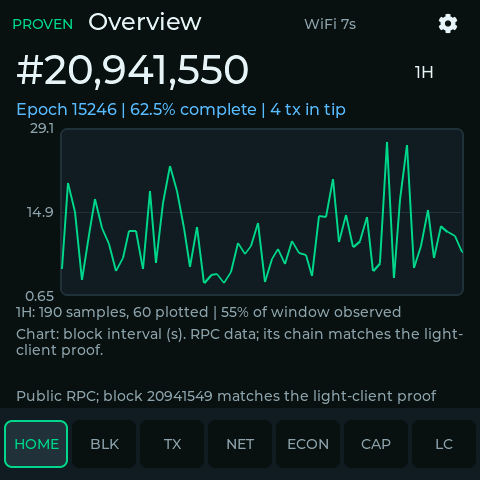
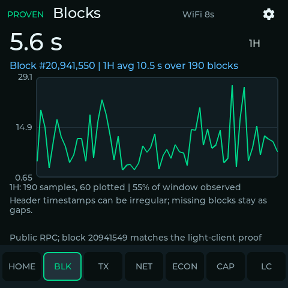
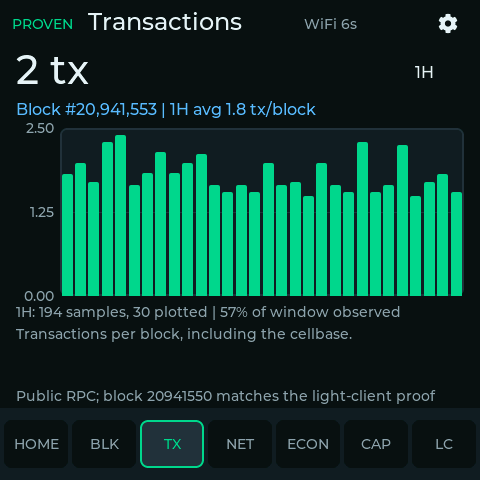
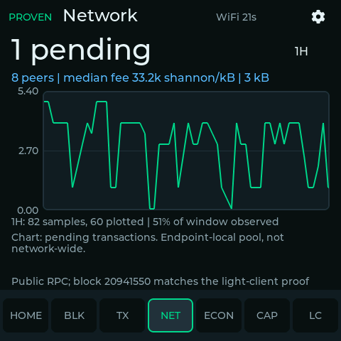
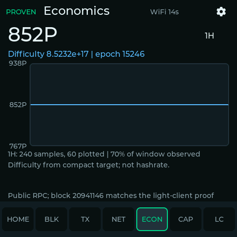
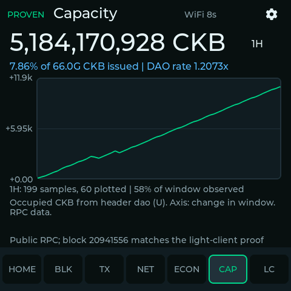
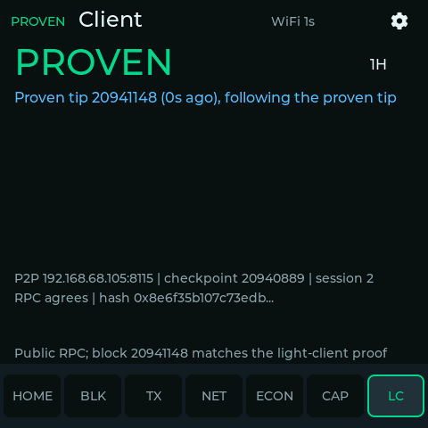

# CKB Chart — Guition ESP32-4848S040C LVGL dashboard

**Status (2026-11-09): live on the Guition against public mainnet RPC, with the on-device light client proving each new tip from a pinned LAN peer and the RPC hash matching it in the device log. A 59.7-hour soak (7–9 Nov) ran with no resets: 6,872 tip proofs, none rejected; 14 one-block tip reorgs handled; internal heap flat (min free 46,503 bytes all run). The device resumes from a checkpoint saved in NVS after a reboot; the badge policy is unit- and mutation-tested. Still open: a real `RPC MISMATCH` against a lying endpoint, testnet, and touch-driven Wi-Fi provisioning end to end. The board needs a powered hub or dedicated supply (it browns out on an unpowered one). See docs/LIGHT_CLIENT.md and docs/VALIDATION.md.**

This is an observation-only 480x480 Nervos CKB dashboard. It has seven screens (Overview, Blocks, Transactions, Network, Economics, Capacity, Client), bottom navigation, swipe navigation, bounded charts, time-window controls, deterministic demo fixtures, and JSON-RPC mode. No wallet keys or signing are supported.

## Screens

Captured from the running board on mainnet (pixel-exact framebuffer renders, not photos). The header label reads `PROVEN` because the public RPC's tip hash matches the one the device proved itself.

<table>
<tr>
<td></td>
<td></td>
<td></td>
</tr>
<tr>
<td align="center">Overview</td><td align="center">Blocks</td><td align="center">Transactions</td>
</tr>
<tr>
<td></td>
<td></td>
<td></td>
</tr>
<tr>
<td align="center">Network</td><td align="center">Economics</td><td align="center">Capacity</td>
</tr>
<tr>
<td></td>
<td colspan="2">

**Client** shows the on-device light client: the tip it proved over P2P, how long ago, whether the RPC endpoint agrees, and the session details.

</td>
</tr>
</table>

To regenerate them, build with `CONFIG_CKB_DEBUG_SCREENSHOTS=y` (in a separate build directory), flash, log the serial port, then run `tools/screenshot_decode.py <log> docs/images --names overview,blocks,transactions,network,economics,capacity,client`. The board cycles through every page and prints each as checksummed text lines; the decoder writes only captures whose FNV-1a hash matches.

## Trust model

- `DEMO`: deterministic synthetic fixtures, never live chain data.
- `RPC`: unverified data from the configured full-node or public RPC endpoint. It is never labeled light-client verified.
- `STALE`: the last valid RPC data remains visible while transport/parsing fails; missing data is not converted to zero.
- Embedded light client: the device proves the mainnet tip itself with RFC44 last-state proofs (ckb-light-esp `3e47434`, from a pinned LAN peer) and compares it with the RPC endpoint's hash. `PROVEN` means only that the RPC agrees with that independently proven tip; `RPC MISMATCH` means it repeatedly did not. Charts stay RPC data under the labels above. See `docs/LIGHT_CLIENT.md` and `docs/UPSTREAM_AUDIT.md`.

Global hashrate, active-address counts, finalized rewards, and circulating-supply estimates are not shown, because no RPC this dashboard trusts provides them. Capacity comes only from the header `dao` field (issued and occupied CKB, DAO rate).

## Reproducible build

Pinned dependencies are in `firmware/main/idf_component.yml` and `firmware/dependencies.lock`:

- ESP-IDF 5.4.0
- LVGL 9.2.2
- `espressif/esp_lcd_st7701` 2.0.2
- `espressif/esp_lcd_panel_io_additions` 1.0.0
- `espressif/esp_lcd_touch_gt911` 1.2.1 (with `esp_lcd_touch` 1.2.1)

The current official `guition/guition_boards` 0.2.2 component requires ESP-IDF 6.1 or newer and was not silently substituted into this 5.4 build. Its `esp32_4848s040` YAML verified the pin map and driver selections. The generic ST7701 init produced color bands on the actual panel; `firmware/main/board.c` now uses the Guition-specific init sequence from the documented working sample, 6 MHz PCLK, HSYNC 8/50/10, VSYNC 8/20/10, two PSRAM RGB565 framebuffers, and 4800-pixel internal bounce buffers.

```bash
source /data/esp/esp-idf-v5.4/export.sh
idf.py -C firmware set-target esp32s3
idf.py -C firmware build
```

On another machine, activate an exact ESP-IDF 5.4.0 installation instead of the local path. The build downloads the pinned registry components. Outputs are:

- `firmware/build/bootloader/bootloader.bin`
- `firmware/build/partition_table/partition-table.bin`
- `firmware/build/ckb_chart.bin`

The custom partition table has a 3 MiB application slot, 24 KiB NVS, and a reserved 12 MiB storage partition on 16 MiB flash. History persistence/LittleFS is not currently implemented.

## Configure DEMO or RPC

Defaults are under **Component config → CKB dashboard** in `idf.py -C firmware menuconfig`.

The default is **public mainnet RPC** at `https://mainnet.ckb.dev/rpc`. Open **Settings → Wi-Fi / node provisioning** to start an asynchronous scan, select an SSID, enter its masked password, and optionally edit the RPC URL. Choose **Save public RPC** or **Save LAN node** to record the endpoint's correct trust label. Settings persist in NVS and trigger a clean reconnect. DEMO remains available from the settings panel.

Do not post credentials in chat or logs. The current board has not yet recorded a successful scan/connection; see `docs/VALIDATION.md` for the qualification gap. Build-time defaults remain available under **Component config → CKB dashboard**. Changing menuconfig does not overwrite existing NVS values; to reprovision with build defaults, erase flash deliberately and then flash again (this also erases settings/history):

```bash
idf.py -C firmware -p PORT erase-flash
idf.py -C firmware -p PORT flash monitor
```

Use HTTPS with the enabled ESP certificate bundle for remote endpoints. Plain HTTP is intended only for an explicitly trusted LAN node. Mainnet and testnet responses must pass both the `get_blockchain_info` chain check and the genesis-hash check. Both hashes are pinned from CKB's published `docs/hashes.toml`.

Confirm the target before flashing. The Guition's USB-serial bridge is a CH340, and its `ttyUSB` number can change after a replug, so use the stable by-id path and check the chip MAC first:

```bash
PORT=/dev/serial/by-id/usb-1a86_USB_Serial-if00-port0
esptool.py -p $PORT --after no_reset read_mac   # must print your board's MAC
idf.py -C firmware -p $PORT flash monitor
```

Do not select a port solely because it reports ESP32-S3; another attached ESP32-S3 may be a different device. If a flash fails partway (USB error, "No bootable app partitions" on boot), re-flash at a lower baud, e.g. `-b 230400`.

## Operation and resource bounds

- LVGL runs only on the UI task (core 1), under a recursive lock.
- Wi-Fi, HTTP, JSON parsing, and backfill run on the network task (core 0).
- The UI queue holds at most 8 fixed-size snapshots; the oldest is dropped when full.
- Each metric keeps at most 480 points in PSRAM and renders at most 240.
- Initial/new-tip backfill fetches at most 20 blocks per poll. The full-block response cap is 768 KiB, with an 8-second timeout.
- Wi-Fi reconnect uses exponential backoff with jitter, capped at 30 seconds.
- Reorg/hash changes invalidate derived history rather than presenting it as canonical.
- The settings panel switches DEMO/RPC, requests reconnect, changes brightness, and clears history.

## Tests and validation

```bash
bash tools/run_host_tests.sh
make -C upstream/ckb-light-esp/test_host clean test
```

The project script runs the JSON-schema/demo contract test and native C tests for hex parsing, epoch boundaries, compact-target difficulty, ring wrapping/replacement, reorg invalidation, coverage, downsampling, header `dao` decoding, chart axis bounds, the light-client badge policy, and the screenshot encoder. The second command runs the light client's own host tests.

Raw serial/flash logs are not published (they contain Wi-Fi scan results, LAN addresses and device MACs); `docs/VALIDATION.md` and `docs/LIGHT_CLIENT.md` record what they showed. Observed commands, binary sizes, RPC schema checks, actual Guition results, runtime memory, the soak results, and unresolved issues are in `docs/VALIDATION.md`. `tools/serial_soak_logger.py` writes timestamped serial logs to the git-ignored `logs/` directory.

## License

MIT. See `LICENSE`.
